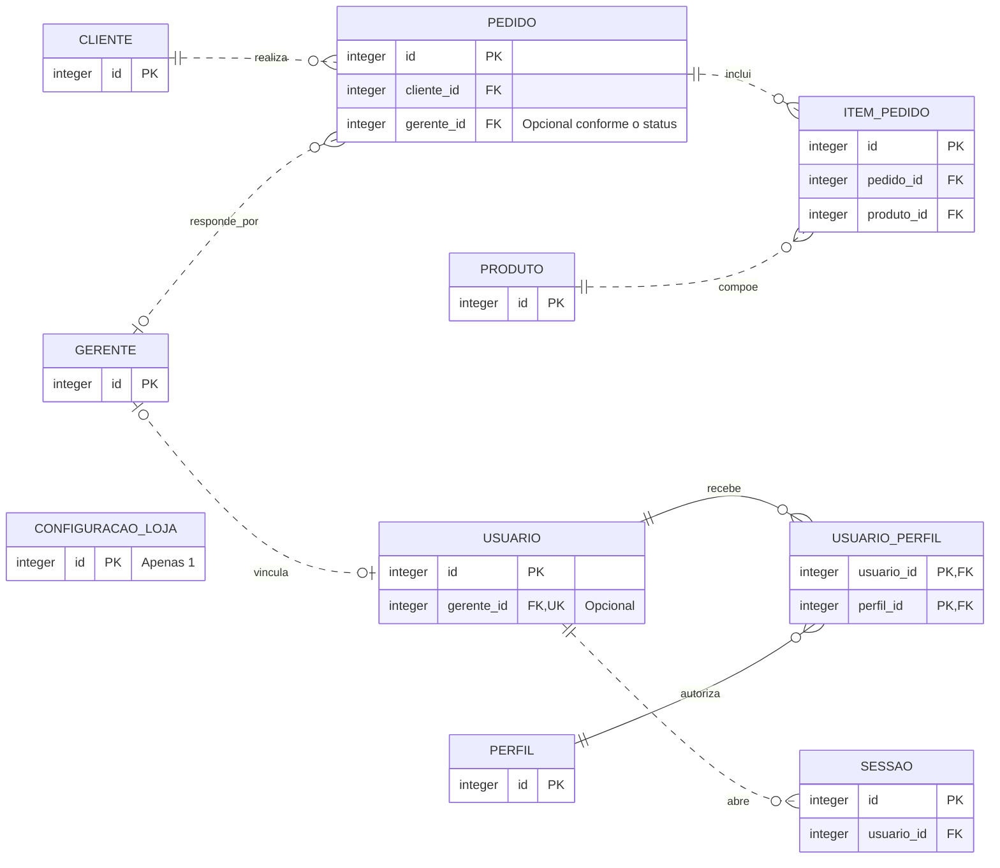

# MER final do Gabi Cake

O modelo após a migração 08 tem 10 tabelas no esquema `public`. O diagrama mostra as chaves e as colunas usadas nos vínculos. O dicionário reúne os atributos restantes e as regras de cada tabela. [Dicionário de dados](dicionario-de-dados.md) · [Scripts de inicialização](../../db/init/)

## Cardinalidades e exclusão

| Vínculo | Cardinalidade no banco | Efeito ao excluir o registro referenciado |
|---|---|---|
| `pedido.cliente_id → cliente.id` | Cada pedido pertence a um cliente. Um cliente pode ter zero ou mais pedidos. | `RESTRICT` protege o cliente referenciado. |
| `pedido.gerente_id → gerente.id` | Cada pedido pode referenciar até um gerente. Um gerente pode estar em vários pedidos. | `RESTRICT` protege o gerente referenciado. |
| `item_pedido.pedido_id → pedido.id` | Cada item pertence a um pedido. A FK admite zero ou mais itens por pedido. | `CASCADE` remove os itens junto com o pedido. |
| `item_pedido.produto_id → produto.id` | Cada item referencia um produto. Um produto pode aparecer em vários itens. | `RESTRICT` protege o produto referenciado. |
| `usuario.gerente_id → gerente.id` | Vínculo opcional de um para um nos dois sentidos. A coluna é única. | `RESTRICT` protege o gerente vinculado à conta. |
| `usuario_perfil.usuario_id → usuario.id` | Cada vínculo pertence a um usuário. Um usuário pode ter vários vínculos. | `CASCADE` remove os vínculos do usuário excluído. |
| `usuario_perfil.perfil_id → perfil.id` | Cada vínculo aponta para um perfil. Vários usuários podem compartilhar o perfil. | `RESTRICT` protege o perfil em uso. |
| `sessao.usuario_id → usuario.id` | Cada sessão pertence a um usuário. O usuário pode ter zero ou mais sessões. | `CASCADE` remove as sessões do usuário excluído. |

As chaves estrangeiras usam `ON UPDATE CASCADE`, exceto `sessao.usuario_id`, que usa o padrão do PostgreSQL, `NO ACTION`. A chave primária composta de `usuario_perfil` admite apenas um vínculo para cada par de usuário e perfil. [Esquema inicial](../../db/init/01-schema.sql) · [Usuários e perfis](../../db/init/04-usuarios-perfis.sql) · [Sessões](../../db/init/07-requisitos-essenciais.sql)

O cadastro de pedidos exige ao menos um item pela API. Para `PENDENTE` e `CANCELADO`, o banco admite `gerente_id` vazio. Para `ATENDIDO`, a alternativa ao ID é um `nome_gerente` preenchido. Os demais status exigem a FK. [Serviço de pedidos](../../backend/src/main/java/com/gabicake/api/service/PedidoService.java) · [Regras de pedido](../../db/init/07-requisitos-essenciais.sql)

A tabela `configuracao_loja` guarda uma configuração global, com chave fixa `1`. Ela pode permanecer vazia até o cadastro da loja e fica sem vínculos físicos com as demais tabelas. [Configuração da loja](../../db/init/07-requisitos-essenciais.sql)