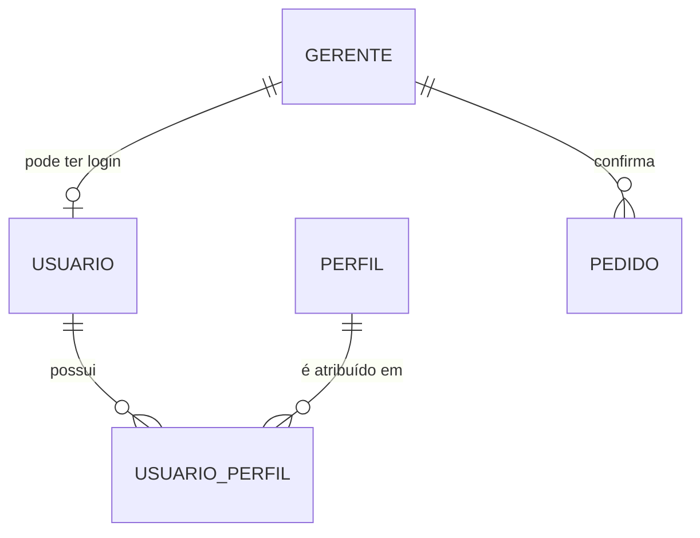

# Migração de usuários e perfis – Gabi Cake

Projeto Integrador II 2026/2 – Equipe 4
Banco de dados: PostgreSQL 16
Arquivos relacionados: `db/init/04-usuarios-perfis.sql`, `db/rollback/04-usuarios-perfis-rollback.sql`, `db/testes/testes-usuarios-perfis.sql` e `docs/evidencias/resultado-testes-usuarios-perfis.txt`

## 1. O que precisávamos resolver

Para o sistema ter login e controle de acesso, o banco precisa saber **quem** pode entrar (usuários) e **o que** cada pessoa pode fazer (perfis). Hoje o banco só tem a tabela `gerente`, que guarda nome e senha com hash, mas ela também é usada como registro de quem confirmou cada pedido. Misturar as duas coisas não escala: o dia que a cliente contratar um funcionário, ele precisaria entrar no sistema sem ser gerente.

Os perfis vieram da Matriz de Autorização. Existem dois: **Gerente**, que cuida de pedidos, clientes, agenda e financeiro, e **Funcionário**, que cuida da rotina de clientes e pedidos, mas não acessa o financeiro nem as configurações da loja. O perfil "Sem login" da matriz não virou registro no banco, porque ele representa justamente quem não está autenticado.

## 2. Como ficou a estrutura



Criamos três tabelas novas e não alteramos nenhuma das que já existiam. A `perfil` guarda os papéis de acesso (`GERENTE` e `FUNCIONARIO`). A `usuario` guarda quem faz login: `login`, `senha_hash` (hash BCrypt, nunca a senha pura), `nome` para exibição, um campo `ativo` que permite bloquear o acesso sem apagar a pessoa e a data de criação. A `usuario_perfil` liga os dois, e escolhemos uma relação muitos-para-muitos, que é o formato padrão do Spring Security e permite, no futuro, uma pessoa acumular perfis sem mudar o banco. Se a equipe preferir algo mais simples (um perfil por pessoa), basta trocar essa tabela por uma coluna `perfil_id` em `usuario`.

A `usuario` tem ainda uma coluna `gerente_id`, opcional e única, que liga o usuário ao seu registro de gerente. Ela existe porque o pedido continua guardando `gerente_id`, e quando o backend precisar registrar quem confirmou um pedido, terá de descobrir o gerente a partir do usuário logado. Para um funcionário, o campo fica vazio.

| Constraint | Regra garantida |
|---|---|
| `uq_perfil_nome`, `ck_perfil_nome` | Nome do perfil único e em MAIÚSCULAS (sem o prefixo `ROLE_`, que o Spring acrescenta). |
| `uq_usuario_login`, `ck_usuario_login` | Login único, em minúsculas, sem espaços, de 3 a 60 caracteres. Como só aceita minúsculas, "GABRIELA.ALMEIDA" e "gabriela.almeida" nunca coexistem. |
| `ck_usuario_senha_hash` | Só aceita valor no formato de hash BCrypt. Gravar uma senha em texto puro é recusado pelo banco. |
| `uq_usuario_gerente`, `fk_usuario_gerente` | Cada gerente tem no máximo um usuário, e o gerente precisa existir. Não dá para apagar um gerente que tem usuário. |
| `fk_usuario_perfil_usuario` | Apagar um usuário apaga os vínculos dele com perfis (`ON DELETE CASCADE`). |
| `fk_usuario_perfil_perfil` | Não dá para apagar um perfil que ainda está em uso (`ON DELETE RESTRICT`). |

Seguimos o mesmo padrão de nomes e de chaves estrangeiras do `01-schema.sql` (`fk_`, `uq_`, `ck_`, `idx_`, com `ON UPDATE CASCADE`).

## 3. O que a migration faz com os dados

Além de criar as tabelas, o script cadastra os dois perfis e **migra os gerentes que já existem**. Cada gerente vira um usuário com o perfil `GERENTE`. O login é gerado a partir do nome, sem acentos, em minúsculas e com ponto no lugar dos espaços (por exemplo, "Gabriela Almeida" vira `gabriela.almeida`). O hash da senha é copiado do próprio gerente, então as senhas atuais continuam valendo: conferimos que os 10 usuários migrados validam a senha do seed com o hash copiado, e que uma senha errada é recusada.

Duas decisões merecem atenção. A primeira é que, se dois gerentes gerarem o mesmo login (por exemplo "Ana Lima" e "ANA LIMA", que o `UNIQUE` atual de `gerente` permite), a migration **falha por inteiro e desfaz tudo**, em vez de pular um deles em silêncio. Preferimos que o problema apareça na hora a ter um gerente sem usuário sem ninguém perceber. A segunda é que, depois da migração, o hash passa a existir em dois lugares (`gerente.senha` e `usuario.senha_hash`). A fonte de verdade para login passa a ser a `usuario`. Quando o backend for atualizado para usá-la, a coluna `gerente.senha` poderá ser removida em uma migration futura, mas não mexemos nela agora para não quebrar o seed e os testes que já existem.

## 4. Como executar

Em um banco novo, o Docker executa o arquivo sozinho, depois do `03-indices.sql`, porque a pasta `db/init` roda em ordem na primeira inicialização:

```bash
docker compose down -v && docker compose up --build
```

Em um banco que já existe, o Docker **não** roda de novo os arquivos de `db/init`, então aplicamos o script à mão. Ele é idempotente: pode ser executado quantas vezes for preciso sem duplicar nada, e roda dentro de uma transação (ou tudo dá certo, ou nada muda).

```bash
docker compose exec -T db psql -U gabicake -d gabicake -v ON_ERROR_STOP=1 \
    < db/init/04-usuarios-perfis.sql
```

Para desfazer, existe o script de rollback, que remove só as três tabelas novas e não toca em `gerente`, `pedido` nem nas demais:

```bash
docker compose exec -T db psql -U gabicake -d gabicake -v ON_ERROR_STOP=1 \
    < db/rollback/04-usuarios-perfis-rollback.sql
```

## 5. Como validamos

Executamos a migration de três formas: num banco novo, rodando 01, 02, 03 e 04 em sequência e parando no primeiro erro, como faz o Docker; num banco já existente, aplicando só o 04; e três vezes seguidas no mesmo banco, para confirmar que nada duplica (sempre 2 perfis, 10 usuários e 10 vínculos). Também testamos o rollback seguido de uma nova aplicação, confirmando que os 10 gerentes e os 15 pedidos continuaram intactos. Nos casos de borda, nomes com acento e apóstrofo viraram logins válidos (`José  Conceição` virou `jose.conceicao`, e `Zoé D'Ávila` virou `zoe.davila`), e a colisão de logins abortou a migration inteira.

Para o critério das chaves estrangeiras, escrevemos um script de testes no mesmo formato da bateria de integridade anterior. Ele confere o resultado da migration (5 verificações) e tenta gravar dados inválidos para ver se o banco recusa com o erro certo: 6 casos de chave estrangeira, 5 de unicidade, 6 de `CHECK` e 1 de `NOT NULL`, além de 3 controles com dados válidos. No total são 26 casos, e todos passaram. O script não grava nada no banco, pois termina com `ROLLBACK`.

Para ter certeza de que os testes realmente detectam problemas, removemos de propósito três constraints numa cópia do banco (`fk_usuario_perfil_perfil`, `uq_usuario_login` e `ck_usuario_senha_hash`). A bateria acusou falha exatamente nos 6 casos ligados a elas e terminou com código de saída diferente de zero.

```bash
docker compose exec -T db psql -U gabicake -d gabicake -v ON_ERROR_STOP=1 \
    < db/testes/testes-usuarios-perfis.sql
```

## 6. O que esta tarefa não inclui

Esta entrega prepara **o banco**. O backend ainda não usa Spring Security, e a tela de login é apenas visual, então nada disso faz o login funcionar sozinho. As entidades JPA de `Usuario` e `Perfil` e a autenticação ficam para a próxima etapa. Isso não atrapalha o que já existe: o backend roda com `ddl-auto=validate`, que só confere as tabelas mapeadas por entidades, então as três tabelas novas não causam erro.

Duas observações para a equipe. Os usuários migrados herdam a senha de teste do seed (`Senha@123`), que serve para desenvolvimento, e precisa ser trocada antes de qualquer uso real. E o projeto não usa uma ferramenta de migrations como Flyway: seguimos a convenção que já existe, com arquivos numerados em `db/init`. Se a equipe adotar o Flyway mais adiante, o arquivo precisará ser renomeado (por exemplo, `V4__usuarios_perfis.sql`) e o `BEGIN`/`COMMIT` removido, pois o Flyway já controla a transação.